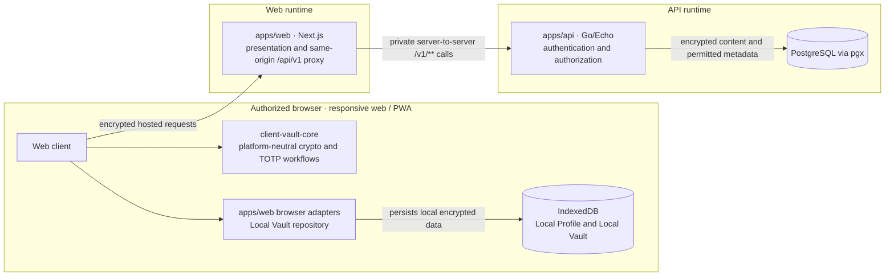

# pnpm workspace monorepo

The repository uses pnpm workspaces as its monorepo boundary. The root `pnpm-lock.yaml` is the sole JavaScript dependency lockfile and `pnpm-workspace.yaml` includes `apps/*` and `packages/*`.

## Workspace map

```text
rhasia-scret/
|-- apps/
|   |-- web/                 Next.js web/PWA, presentation, same-origin API proxy
|   `-- api/                 Go/Echo API, authorization, PostgreSQL persistence and Sqitch migrations
|-- packages/
|   |-- api-contract/        Shared API request/response contracts
|   |-- api-client/          Platform-neutral direct HTTP adapter
|   `-- client-vault-core/   Platform-neutral client workflows and contracts
|-- docs/                    Product, architecture, security and operations guides
|-- tools/                   Repository, test and deployment automation
|-- pnpm-workspace.yaml      Workspace package discovery
`-- pnpm-lock.yaml           Sole JavaScript dependency lockfile
```

## Runtime flow



## Ownership and boundaries

| Workspace                                       | Owns                                                                                                                                                                                                                                                                            |
| ----------------------------------------------- | ------------------------------------------------------------------------------------------------------------------------------------------------------------------------------------------------------------------------------------------------------------------------------- |
| `apps/api`                                      | Canonical `/v1/**` Go/Echo runtime, bounded contexts, pgx persistence, Sqitch migrations, email/auth adapters, retention scheduling, and deployment configuration. Vercel and Docker use the same Go API. TypeScript/Prisma source remains an isolated parity oracle for tests. |
| `apps/web`                                      | Next.js presentation, same-origin `/api/v1/**` proxy, browser adapters, localization catalogs, SSR API gateway, and web tests/configuration. It has no database or backend-module ownership.                                                                                    |
| `packages/client-vault-core`                    | Platform-neutral client workflows and contracts. It exposes `src/index.ts`; it does not depend on either application, React, Prisma, filesystem, browser, or platform-storage APIs.                                                                                             |
| `packages/api-contract` / `packages/api-client` | Shared API schemas and a platform-neutral direct HTTP adapter.                                                                                                                                                                                                                  |

Applications may depend on shared packages through `workspace:*`, but must not import each other or reach into shared-package internals. Browser capabilities remain injected ports implemented by `apps/web`. Server-owned web code may import only the encrypted Personal-only snapshot, transient workspace parser/contracts, and deterministic Shared Vault permission policy/types from `client-vault-core`. An architecture test rejects all other package symbols—including crypto, decryption, unlock, archive-opening, Secure Share, and OTP workflows—as well as default, namespace, wildcard, inline, and dynamic package imports at server boundaries.

## Commands

```bash
mise install
mise run setup
pnpm install --frozen-lockfile
pnpm dev                         # starts local Go API, waits for health, then web
pnpm run dev:api                 # local Go API only
pnpm run dev:web                 # web only
pnpm --filter @rhasia-scret/api-parity test:unit # TypeScript parity-oracle tests only
pnpm dev:db                      # start local Compose PostgreSQL
pnpm dev:mailpit                 # start local TLS-enabled Mailpit
pnpm dev:db:migrate              # explicitly apply local development migrations
pnpm dev:down                    # confirm, then stop PostgreSQL and Mailpit
pnpm dev:db:down                 # stop the full dev Compose project, preserve its volume
pnpm selfhosted:install          # configure, pull/start services, and apply selected Tailscale route
pnpm selfhosted:setup            # configure database and apply migrations from the published image
pnpm selfhosted:up               # pull versioned images and start self-hosted Compose services
pnpm selfhosted:down             # stop services, preserve database volume
pnpm selfhosted:clean            # confirm and delete self-hosted PostgreSQL data
pnpm run lint
pnpm run typecheck
pnpm test
pnpm run test:hosted
pnpm run test:container
pnpm run test:parallel
pnpm run test:architecture
pnpm run build
pnpm run test:full:core
pnpm run test:full:web
pnpm run test:full
pnpm run test:full:hosted
pnpm run test:unit:api
pnpm --filter @rhasia-scret/api-parity test:integration
pnpm run test:integration:container
pnpm run test:full:container
pnpm run verify:version-alignment
pnpm run test:release-process
pnpm release:patch
pnpm release:minor
pnpm release:major
pnpm release:update
```

## Local development setup

Use the mise-managed Node.js/pnpm versions from `.mise.toml`. After `mise install` and `mise run setup`, run `pnpm install --frozen-lockfile` to install workspace dependencies, then create `.env` from `.env.example` if needed. Configure `POSTGRES_USER`, `POSTGRES_PASSWORD`, and `POSTGRES_DB` for the local Compose database, and point both `DATABASE_URL` and `DIRECT_URL` to that database through `127.0.0.1:${POSTGRES_HOST_PORT:-55432}`. Follow [authentication configuration](authentication-configuration.md) and [self-hosting](self-hosting.md) when selecting local-only or passwordless mode. Do not point development migrations at a persistent or production database.

Start the local database and, when its schema needs updating, apply migrations explicitly:

```bash
pnpm dev:db
pnpm dev:db:migrate
pnpm dev:mailpit
pnpm dev
```

`pnpm dev:mailpit` starts the shared development Mailpit service; `pnpm dev` and `pnpm run dev:api` also ensure it is running when `LOCAL_EMAIL_PROVIDER` is `mailpit` (the default). The service requires local Docker and OpenSSL. Open `http://localhost:8026` by default to inspect captured messages; `pnpm dev:mailpit` prints the active address if the UI port is customized. Its TLS certificate and key stay in the private, ignored `.local-mailpit/` directory; the local API trusts that certificate. Set `LOCAL_EMAIL_PROVIDER=smtp` to explicitly use the SMTP settings in `.env` instead. `pnpm dev:down` requires typing `yes`, then stops only the development PostgreSQL and Mailpit services; it preserves the PostgreSQL volume and local Mailpit TLS files. The migration command requires typing `yes`. `pnpm dev:db:down` stops the full development Compose project without deleting its named volume. `pnpm dev:db:reset` is destructive: it deletes that volume, creates a fresh PostgreSQL container, and reapplies development migrations after confirmation. The `selfhosted:*` commands use a separate Compose override that pulls versioned Docker Hub images instead of building Web/API images locally; see the [self-hosting guide](self-hosting.md) for image selection, configuration, and migration behavior. Local-development Compose retains its source builds.

The Go API uses the pinned Go 1.27.4 toolchain and pgx at runtime. The TypeScript/Prisma implementation remains in `@rhasia-scret/api-parity` as test-only behavioral evidence; its isolated scripts may generate Prisma Client with a synthetic, non-production URL, but no Go runtime, Docker image, Vercel function, or migration image uses Prisma. API runtime traffic uses `DATABASE_URL`; only the isolated Sqitch migration job receives `DIRECT_URL`.

`test` and `test:full` use disposable database wrappers locally; their `:hosted` commands target an already-provisioned test service. Locally, the wrappers create a fresh PostgreSQL 16 Testcontainer, override both database URLs, build and run the isolated Sqitch migration image, then run TypeScript parity and Go integration tests. They remove the run-owned container, data volume, migration container, and image and verify cleanup. In CI, the quality and release-evidence jobs use job-owned PostgreSQL 16 services and apply the same Sqitch baseline before Go and TypeScript persistence tests. `REQUIRE_DATABASE_INTEGRATION=1` fails fast if integration coverage is unavailable. The TypeScript/Prisma API package is test-only; it remains as a behavioral oracle and must not be treated as a production runtime or migration path. Agents may run the root `pnpm test` and `pnpm run test:full` wrappers when `CI` is not `true`; this does not authorize `:hosted` commands or persistent databases. For another run-owned Compose test stack, obtain a fresh ID with `node tools/confirm-database-operation.mjs --new-disposable-run-id rhasia-scret-test`, then run the scope verifier described in `AGENTS.md`; it requires a repository-owned Compose project on a local Docker context, project-prefixed PostgreSQL data volume, loopback-only access, matching URLs, and synthetic-data classification. Preserve logs separately, then verify all run-owned resources are removed. `test:parallel` runs the normal package suites concurrently without changing deterministic sequential `test` behavior.

Playwright projects use isolated browser contexts. Smoke tests use file-level parallelism by default, bounded to three local workers and one worker per CI suite/browser matrix job, while E2E and PWA tests use test-level parallelism where their isolated scenarios support it. Set `PLAYWRIGHT_FULLY_PARALLEL=1` to opt the smoke suite into test-level parallelism on capable environments; use `PLAYWRIGHT_FULLY_PARALLEL=0` to force file-level sequencing when diagnosing shared-resource failures. Override worker capacity for local or CI environments with `PLAYWRIGHT_WORKERS=50%` (or a positive integer). Browser E2E data uses browser/scenario-specific synthetic, non-PII identities so concurrent workers do not share mutable Vault fixtures; never use user-provided account data.

GitHub Actions runs change detection, repository policy, affected core/web checks, two Chromium development browser matrix cells, and production PWA/navigation checks independently on pushes to `main` and pull requests targeting `main`. Firefox and WebKit are commented out of hosted CI and are not part of the required support signal. Standard CI jobs have an eight-minute hard timeout; the combined production PWA and navigation performance job has a twelve-minute ceiling because it runs two browser stages after cold setup. Job-scoped concurrency cancels only superseded work in the same check family. See [browser test runtime](browser-test-runtime.md) for the measured bottlenecks and coverage-preserving distribution. The CI quality/browser jobs also run on pull requests targeting `main`, and their checks are required for merging. The formatting check runs on pull requests and pushes to `main`; CodeQL, dependency review, and secret scanning provide the remaining fork-safe pull-request checks. These workflows use only checked-in synthetic values and receive no provider, deployment, signing, or database secrets. This hosted signal does not replace local evidence: the merging agent must run a fresh successful `pnpm run test:full` from the repository root after the final code or configuration change and before merging into `main`.

Web deployment keeps the repository root as the Vercel project root so pnpm can resolve the shared lockfile and workspace packages. Vercel installs only `@rhasia-scret/web` and its workspace dependencies, then runs the root `pnpm build` command from `vercel.json`; leave Output Directory unset. Vercel requires Node.js `24.x` in the root and web package engine declarations; local mise and GitHub Actions pin Node.js 24.19.0. The web build has no Prisma or database dependency. Both Vercel projects retain their `main`-only Git deployment rules and `tools/vercel-ignore.mjs` filters; install metadata and filter changes fail open. The Web project remains rooted at the repository root, and its `API_ORIGIN`/`API_PROXY_SECRET` proxy contract is unchanged. The separate API Vercel project is rooted at `apps/api`; its configuration uses Go functions, the same Go/Echo runtime as Docker, the existing `/v1/**` rewrites, region `sin1`, and the existing `main` deployment rule. No API secret is placed in Web environment variables. The dedicated release workflow publishes only after exact-SHA checks; it does not deploy Vercel or migrate an operational database. The Go API receives only pooled `DATABASE_URL`; the isolated Sqitch migration image receives `DIRECT_URL`. Vercel startup and request paths never run migrations. GitHub Actions runs Go, parity, quality, and browser checks on pushes to `main` and pull requests targeting `main`; pull-request security checks remain in their dedicated workflows.
